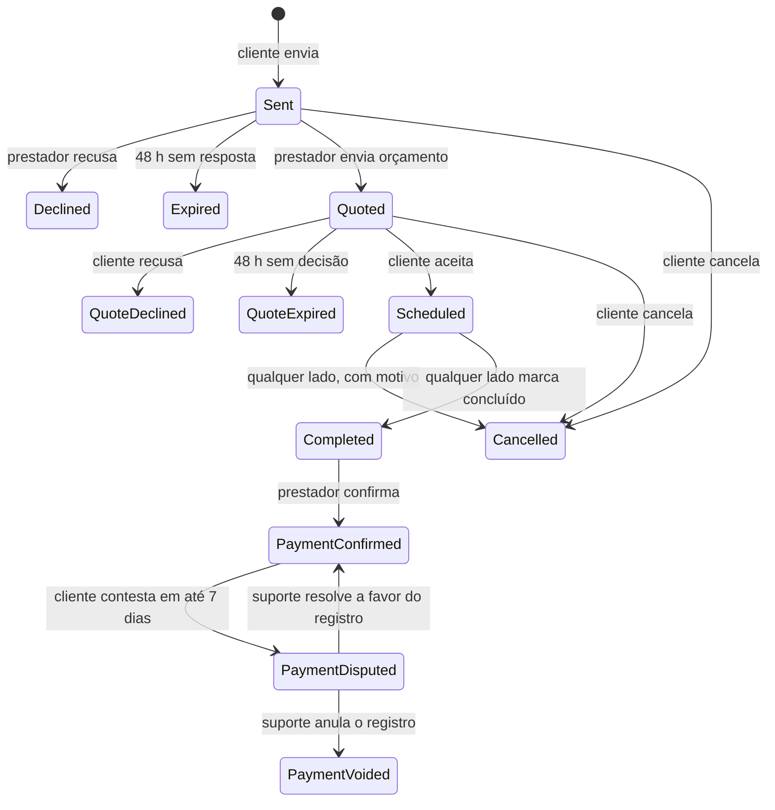

# Regras de negócio

As regras abaixo valem para app, API e moderação. Quando uma spec contradisser este documento, a spec aprovada mais recente vence e este documento é atualizado.

## 1. Contas e papéis

- Uma conta pode ser **cliente** e **prestador** ao mesmo tempo. O papel de prestador nasce quando a pessoa cria a vitrine.
- Papéis de sistema: `customer` (todos), `provider` (quem tem vitrine), `admin` (equipe Vitrio). `admin` nunca é atribuído pelo app.
- Login só por provedor externo no MVP (Google e Apple). E-mail é único por conta; o vínculo é pelo identificador do provedor, não pelo e-mail.
- Conta suspensa não entra; a vitrine some da busca e pedidos em aberto são cancelados com motivo "Conta suspensa".
- Excluir conta: dados pessoais apagados ou anonimizados em até 30 dias; avaliações feitas permanecem com autor "Usuário removido"; registros de pagamento confirmados são mantidos anonimizados por 5 anos para contestação e auditoria.

## 2. Localização e cidades

- Toda cidade é identificada pelo **código IBGE** (7 dígitos). A base contém todos os municípios do Brasil.
- **Com GPS:** a busca usa o ponto do aparelho; a cidade é descoberta pelo ponto (dentro do limite do município). O app não guarda histórico de localização; o ponto é usado na requisição e descartado.
- **Sem GPS:** o cliente escolhe a cidade; o centro da busca é o centroide do município e a distância não é exibida.
- O cliente pode buscar em qualquer cidade, independentemente de onde está.
- Prestador tem **uma cidade base** (do endereço base) e atende num **raio** de 1 a 50 km. O raio pode cruzar o limite da cidade: um prestador de Jaboticabal com 30 km aparece para quem está em Monte Alto.
- Um prestador aparece para um ponto quando a distância entre o ponto e o endereço base é menor ou igual ao raio dele.
- **Privacidade do prestador:** o endereço base nunca é exposto. A API trabalha com um **ponto público** (o endereço base deslocado para o centro de uma célula de ~500 m). Distâncias exibidas são calculadas a partir do ponto público e arredondadas: uma casa decimal até 10 km, inteiro acima, mínimo "< 1 km".
- Bairros vêm do CEP (consulta de CEP) e são texto normalizado por cidade; não existe lista oficial nacional de bairros.

## 3. Vitrine do prestador

- Campos mínimos para publicar: nome de exibição, ao menos 1 categoria, endereço base, raio, telefone de contato, texto "Sobre" com 40+ caracteres e ao menos 1 serviço. Foto é recomendada, não obrigatória.
- Até 3 categorias, 20 serviços e 30 fotos.
- Preço de serviço: "a partir de" (valor em reais) ou "Sob orçamento". O "a partir de" do card de busca é o menor preço entre os serviços.
- Estados da vitrine: `Draft` → `Published` ⇄ `Paused`; `Suspended` só por moderação.
- "Disponível hoje" desliga sozinho às 23:59 no fuso da cidade base.
- **Selo MEI verificado:** concedido quando o CNPJ informado está ativo e optante pelo MEI na consulta pública da Receita. Revalidado a cada 30 dias; se deixar de valer, o selo cai e o prestador é avisado. O selo atesta o CNPJ, não a identidade da pessoa; o texto da interface diz "MEI verificado (CNPJ ativo)".
- Um CNPJ só pode estar ligado a uma vitrine.
- Tempo de resposta exibido ("Responde em ~15 min") é a mediana dos últimos 20 pedidos respondidos, arredondada para 15 min, 30 min, 1 h, 3 h, 1 dia. Menos de 5 respostas: não exibe.

## 4. Pedidos e orçamentos

### Estados

### Regras

- Um cliente pode ter no máximo **3 pedidos em `Sent`** ao mesmo tempo para o mesmo serviço (evita disparo em massa) e **10 pedidos abertos** no total.
- O cliente não pode pedir orçamento para a própria vitrine.
- O pedido guarda uma **cópia** do endereço escolhido (não uma referência), para que editar o endereço depois não mude pedidos antigos.
- Antes do aceite, o prestador vê só **bairro, cidade e distância**. O endereço completo é liberado na transição para `Scheduled` e fica visível ao prestador até 7 dias depois de `Completed` ou `Cancelled`.
- Orçamento: tipo `FixedPrice` (valor do serviço) ou `TechnicalVisit` (valor da visita), valor entre R$ 1,00 e R$ 100.000,00, data e faixa de horário, material incluso (sim/não), mensagem até 500 caracteres. Um orçamento por pedido; o prestador pode **substituir** o orçamento enquanto o pedido estiver em `Quoted` (o prazo de 48 h recomeça).
- Cancelamento em `Scheduled` exige motivo (lista + texto opcional). Cancelamentos do prestador com menos de 2 h do horário contam para uma métrica interna de confiabilidade.
- `Completed` pode ser marcado por qualquer lado a partir do início da faixa agendada. O outro lado recebe aviso e pode discordar pelo suporte em até 48 h.
- Pedidos em `Sent` e `Quoted` expiram por job agendado; a expiração é idempotente.

## 5. Pagamento confirmado pelo prestador

- O pagamento é **combinado fora do app**. O Vitrio não cobra, não intermedeia e não guarda dados de pagamento no MVP.
- **Só o prestador** do pedido confirma o recebimento, e só a partir de `Completed`.
- Dados da confirmação: valor recebido, meio (`Pix`, `Cash`, `DebitCard`, `CreditCard`, `BankTransfer`, `Other`), data e hora do recebimento (não pode ser futura nem anterior à criação do pedido) e observação opcional (até 300 caracteres).
- O valor vem pré-preenchido com o orçamento aceito. Se for diferente, **motivo da diferença** é obrigatório.
- A confirmação é **imutável**. Erro de digitação se corrige anulando (pelo próprio prestador em até 24 h, com motivo) e confirmando de novo; tudo fica no histórico de auditoria.
- O cliente vê o registro e pode **contestar** em até 7 dias com motivo. A contestação vai para a fila do suporte e não impede o cliente de avaliar.
- Contestações procedentes anulam o registro (`PaymentVoided`) e contam contra o prestador na moderação.
- O resumo de recebimentos do prestador soma só confirmações válidas (não anuladas).

## 6. Avaliações

- Só o **cliente do pedido** avalia, e só a partir de `Completed`. Uma avaliação por pedido.
- Conteúdo: nota inteira 1–5 (obrigatória), tags de uma lista fixa (Pontual, Caprichoso, Preço justo, Explicou bem, Deixou tudo limpo, Educado), comentário até 400 caracteres, até 3 fotos, "Recomendo" (sim/não).
- Pode ser editada por 7 dias após publicar; depois fica fixa.
- O prestador responde **uma vez** (até 400 caracteres); pode editar a resposta por 7 dias.
- Nota exibida = **média bayesiana**: `(C × m + soma das notas) / (C + n)`, com `C = 5` e `m` = média global da categoria principal. Exibida com uma casa decimal. Com menos de 3 avaliações, mostra "Novo no Vitrio" em vez da nota na busca (o perfil mostra as avaliações que houver).
- Autor exibido: primeiro nome + inicial do sobrenome ("Beatriz F.").
- Avaliação não pode conter telefone, e-mail ou link (validação na API; o texto é recusado com mensagem clara).
- O prestador não pode avaliar a si mesmo nem ser avaliado a partir de uma conta que compartilhe o mesmo telefone verificado ou aparelho (sinal registrado para moderação).

## 7. Denúncias e moderação

- Alvos: vitrine, foto, avaliação, resposta, pedido.
- Motivos: informação falsa, conteúdo ofensivo, golpe ou cobrança indevida, foto imprópria, spam, outro.
- Um usuário denuncia o mesmo alvo uma vez. Conteúdo com **3 denúncias abertas de pessoas diferentes** fica oculto até revisão.
- Ações de moderação: manter, ocultar, restaurar, suspender conta (com prazo ou definitiva), anular registro de pagamento. Toda ação exige motivo e gera registro de auditoria.

## 8. Notificações

- Eventos: novo pedido, orçamento recebido, orçamento aceito, pedido recusado ou expirado, lembrete 1 h antes, serviço concluído, pagamento confirmado, contestação aberta, convite para avaliar (2 h após concluído), nova avaliação, resposta à avaliação, selo MEI perdido, conteúdo ocultado.
- Push respeita preferências por tipo, exceto avisos de conta e segurança.
- Silêncio noturno: lembretes e convites não são enviados entre 22h e 7h no fuso do destinatário; ficam para as 7h.

## 9. Limites e números de referência

| Regra | Valor |
| --- | --- |
| Prazo de resposta a pedido | 48 h |
| Validade do orçamento | 48 h |
| Pedidos em aberto por cliente | 10 |
| Pedidos `Sent` por cliente e serviço | 3 |
| Fotos por pedido | 5 |
| Fotos por avaliação | 3 |
| Fotos por vitrine | 30 |
| Categorias por vitrine | 3 |
| Serviços por vitrine | 20 |
| Raio de atendimento | 1–50 km |
| Edição de avaliação | 7 dias |
| Prazo de contestação de pagamento | 7 dias |
| Anulação de confirmação pelo prestador | 24 h |
| Denúncias para ocultar | 3 de pessoas diferentes |
| Revalidação do selo MEI | 30 dias |
