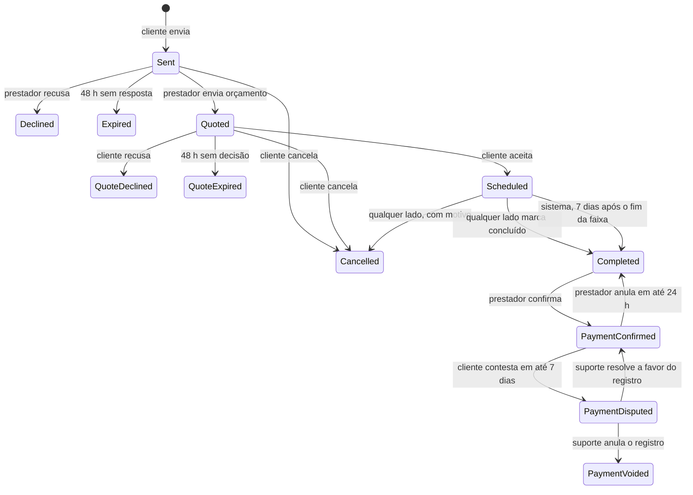

# Regras de negócio

As regras abaixo valem para app, API e moderação. Quando uma spec contradisser este documento, a spec aprovada mais recente vence e este documento é atualizado.

## 1. Contas e papéis

- Uma conta pode ser **cliente** e **prestador** ao mesmo tempo. O papel de prestador nasce quando a pessoa cria a vitrine.
- Papéis de sistema: `customer` (todos), `provider` (quem tem vitrine), `admin` (equipe Vitrio). `admin` nunca é atribuído pelo app.
- **Cadastro e login próprios**, sem provedor externo: nome, e-mail e senha. O e-mail é confirmado com um código de 6 dígitos (10 min, 5 tentativas) antes do primeiro acesso; conta não confirmada em 24 h é apagada.
- E-mail é único por conta. Cadastro, reenvio de código e "Esqueci a senha" respondem igual exista o e-mail ou não, e o login erra sempre com a mesma mensagem, para ninguém descobrir quais e-mails têm conta.
- Senha de 10 a 128 caracteres, sem regra de maiúscula ou símbolo, recusando senhas comuns. Cinco erros em 15 min bloqueiam o login da conta por 15 min; redefinir a senha desbloqueia.
- **Continuar conectado:** a sessão é renovada pelo app e só expira depois de 60 dias sem uso ou 1 ano desde o login. Sair, trocar ou redefinir a senha, desconectar o aparelho em "Aparelhos conectados", suspensão e exclusão encerram a sessão antes.
- Conta suspensa não entra e todas as sessões dela são revogadas; a vitrine some da busca e os pedidos abertos (`Sent`, `Quoted`, `Scheduled`) em que a pessoa é cliente ou prestador são cancelados com motivo "Conta suspensa".
- Excluir conta: dados pessoais apagados ou anonimizados em até 30 dias; avaliações feitas permanecem com autor "Usuário removido"; registros de pagamento confirmados e a auditoria deles são mantidos anonimizados por 5 anos.
- A exclusão é bloqueada (409) enquanto houver pedido `Scheduled` ou contestação de pagamento aberta, como cliente ou como prestador. Pedidos `Sent` e `Quoted` são cancelados com motivo "Conta excluída".
- Se a conta tem vitrine, ela passa a `Removed`: some da busca e do perfil público, o CNPJ fica livre para outra vitrine e as avaliações recebidas deixam de aparecer (continuam guardadas, ligadas aos pedidos).

## 2. Localização e cidades

- Toda cidade é identificada pelo **código IBGE** (7 dígitos). A base contém todos os municípios do Brasil.
- **Com GPS:** a busca usa o ponto do aparelho; a cidade é descoberta pelo ponto (dentro do limite do município). O app não guarda histórico de localização; o ponto é usado na requisição e descartado.
- **Sem GPS:** o cliente escolhe a cidade. Aparecem os prestadores com cidade base nela e os de fora cujo raio, medido do ponto público, alcança o limite do município. A distância não é exibida.
- O cliente pode buscar em qualquer cidade, independentemente de onde está.
- Prestador tem **uma cidade base** (do endereço base) e atende num **raio** de 1 a 50 km. O raio pode cruzar o limite da cidade: um prestador de Jaboticabal com 30 km aparece para quem está em Monte Alto.
- Um prestador aparece para um ponto quando a distância entre o ponto e o **ponto público** dele é menor ou igual ao raio. O endereço base nunca entra no filtro: filtrar pelo endereço exato permitiria descobri-lo variando o ponto da busca e observando onde o prestador aparece e some.
- **Privacidade do prestador:** o endereço base nunca é exposto. A API trabalha com um **ponto público** (o endereço base deslocado para o centro de uma célula de ~500 m). Distâncias exibidas são calculadas a partir do ponto público e arredondadas: uma casa decimal até 10 km, inteiro acima, mínimo "< 1 km".
- Bairros vêm do CEP (consulta de CEP) e são texto normalizado por cidade; não existe lista oficial nacional de bairros.

## 3. Vitrine do prestador

- Campos mínimos para publicar: nome de exibição, ao menos 1 categoria, endereço base, raio, telefone de contato, texto "Sobre" com 40+ caracteres e ao menos 1 serviço. Foto é recomendada, não obrigatória.
- Até 3 categorias, 20 serviços e 30 fotos.
- Preço de serviço: "a partir de" (valor em reais, com unidade: por serviço, hora, dia, m² ou unidade) ou "Sob orçamento".
- O "a partir de" do card de busca é o menor preço por serviço; sem preço por serviço, o menor preço de outra unidade, sempre com a unidade ("a partir de R$ 15/m²"). O filtro de preço máximo e a ordenação por preço consideram só preços por serviço.
- Estados da vitrine: `Draft` → `Published` ⇄ `Paused`; `Suspended` só por moderação; `Removed` quando a conta é excluída. A vitrine não é ocultada automaticamente por denúncias (§7).
- "Disponível hoje" vale só no dia em que foi ligado, no fuso da cidade base. O selo é calculado na leitura (tabela abaixo), então não depende de job para desligar.
- **Selo MEI verificado:** concedido quando o CNPJ informado está ativo e optante pelo MEI na consulta pública da Receita. Revalidado a cada 30 dias; se deixar de valer, o selo cai (`Lost`) e o prestador é avisado. Se a consulta estiver indisponível, a verificação fica `Pending` e é repetida a cada 6 h; depois de 3 dias sem resposta vira `Failed` com o motivo "Não conseguimos consultar o CNPJ agora", o prestador é avisado e pode tentar de novo. O selo atesta o CNPJ, não a identidade da pessoa; o texto da interface diz "MEI verificado (CNPJ ativo)".
- Um CNPJ só pode estar ligado a uma vitrine ativa; vitrine `Removed` libera o CNPJ.

### Selos e números do perfil

Todos são calculados pela API a partir dos dados atuais. Nenhum é gravado à mão nem fica para sempre: quando a condição deixa de valer, o selo sai. Recálculos partem do zero (nunca por incremento), para dar o mesmo resultado se rodarem duas vezes, e toda mudança invalida o cache do perfil ([09-cache.md §3](09-cache.md)). Os eventos e handlers citados abaixo estão no catálogo de [10-eventos.md](10-eventos.md) §9.

| Selo ou número | Regra | Recalculado quando | Some quando |
| --- | --- | --- | --- |
| MEI verificado | Verificação do CNPJ com status `Verified` | Na verificação e na revalidação a cada 30 dias (job diário em lotes) | Revalidação falha (`Lost`) ou consulta pendente por mais de 3 dias (`Failed`) |
| Disponível hoje (e a lista "Disponíveis agora") | `AvailableToday` ligado **e** ligado hoje no fuso da cidade base | Na leitura, a cada requisição | Na virada do dia no fuso da cidade, sem depender de job |
| Responde em ~X | Mediana do tempo até a primeira resposta (§4) nos **últimos 20 pedidos recebidos nos últimos 90 dias**. Pedido ignorado até expirar conta como 48 h; pedido cancelado pelo cliente antes da resposta fica fora. Faixas: até 15 min, 30 min, 1 h, 3 h e 1 dia | Handler de `QuoteSent`, `OrderDeclined` e `OrderExpired`; job diário para a janela de 90 dias andar | Mediana acima de 1 dia ou menos de 5 pedidos na amostra |
| Nota ou "Novo no Vitrio" | Média bayesiana (§6) com 3 ou mais avaliações visíveis; abaixo disso, "Novo no Vitrio" no lugar da nota | Handler dos eventos `review.published`, `review.updated`, `content.hidden` e `content.restored`; job diário que recalcula a média da categoria e todas as notas | — |
| Serviços feitos pelo app | Pedidos em `Completed`, `PaymentConfirmed` ou `PaymentDisputed` (pagamento anulado pelo suporte não conta). Exibido a partir de 5 | Handler dos eventos `order.completed` e `payment.dispute_resolved` (anulado) | Anulação pelo suporte reduz a contagem |
| Tags mais citadas | Contagem das tags nas avaliações visíveis | Junto com a nota | — |
| Distância ("perto de você") | Do ponto público do prestador ao ponto do cliente, arredondada (§2); só com GPS | Em cada requisição | Sem GPS não aparece |

Pedidos ignorados derrubam o "Responde em ~X": cada pedido que expira entra na amostra como 48 h e empurra a mediana para cima. Quem para de receber pedidos perde o selo quando a janela de 90 dias passa.

## 4. Pedidos e orçamentos

### Estados

### Regras

- `PaymentVoided` é final: depois de o suporte anular o registro, uma nova confirmação só pelo suporte.
- Um cliente pode ter no máximo **3 pedidos em `Sent`** ao mesmo tempo na mesma categoria (evita disparo em massa) e **10 pedidos abertos** (`Sent`, `Quoted` ou `Scheduled`) no total. A categoria do pedido é a do serviço escolhido ou, em "Outro", a categoria principal do prestador.
- O cliente não pode pedir orçamento para a própria vitrine.
- O pedido guarda uma **cópia** do endereço escolhido (não uma referência), para que editar o endereço depois não mude pedidos antigos.
- Para pedir orçamento, a conta precisa ter celular; o pedido guarda uma cópia do nome completo e do celular, como faz com o endereço.
- Antes do aceite, o prestador vê só **primeiro nome + inicial do cliente, bairro, cidade e distância**. O endereço completo, o nome completo e o celular são liberados na transição para `Scheduled` (`AddressReleasedAt`) e fica visível ao prestador até 7 dias depois do fim da faixa agendada, qualquer que seja o status depois disso. Cancelamento fecha o acesso na hora.
- Pedido sem coordenadas do endereço (CEP sem ponto, endereço preenchido à mão) usa o centroide da cidade: a distância aparece como aproximada e o aviso de "fora da área" não é mostrado.
- Tempo de resposta do prestador: da criação do pedido até a primeira resposta (`FirstResponseAt`), que é o primeiro orçamento enviado ou a recusa.
- Orçamento: tipo `FixedPrice` (valor do serviço) ou `TechnicalVisit` (valor da visita), valor entre R$ 1,00 e R$ 100.000,00, data e faixa de horário, material incluso (sim/não), mensagem até 500 caracteres. Um orçamento por pedido; o prestador pode **substituir** o orçamento enquanto o pedido estiver em `Quoted` (a versão aumenta e a validade recomeça).
- Validade do orçamento: o que vier primeiro entre 48 h depois do envio e 1 h antes do início da faixa proposta. Orçamento para um horário que já passou não pode ser aceito.
- Cancelamento em `Scheduled` exige motivo (lista + texto opcional). Cancelamentos do prestador com menos de 2 h do horário ficam registrados no prestador (`LateCancellations`, janela de 90 dias, recalculada no `OrderCancelled`). Três ou mais na janela colocam o prestador na fila de moderação para revisão; não há efeito automático nem exibição pública.
- `Completed` pode ser marcado por qualquer lado a partir do início da faixa agendada. O outro lado recebe aviso e pode discordar pelo suporte em até 48 h.
- Se ninguém marcar, o sistema conclui o pedido 7 dias depois do fim da faixa agendada (`CompletedBy = System`); os dois são avisados e quem discordar fala com o suporte.
- Pedidos em `Sent` e `Quoted` expiram por job agendado; a expiração e a conclusão automática são idempotentes.

## 5. Pagamento confirmado pelo prestador

- O pagamento é **combinado fora do app**. O Vitrio não cobra, não intermedeia e não guarda dados de pagamento no MVP.
- **Só o prestador** do pedido confirma o recebimento, e só a partir de `Completed`.
- Dados da confirmação: valor recebido, meio (`Pix`, `Cash`, `DebitCard`, `CreditCard`, `BankTransfer`, `Other`), data e hora do recebimento (não pode ser futura nem anterior à criação do pedido) e observação opcional (até 300 caracteres).
- O valor vem pré-preenchido com o orçamento aceito. Se for diferente, **motivo da diferença** é obrigatório.
- A confirmação é **imutável**. Erro de digitação se corrige anulando (pelo próprio prestador em até 24 h, com motivo; o pedido volta a `Completed`) e confirmando de novo; tudo fica no histórico de auditoria.
- O cliente vê o registro e pode **contestar** em até 7 dias com motivo. A contestação vai para a fila do suporte e não impede o cliente de avaliar.
- Contestações procedentes anulam o registro (`PaymentVoided`) e contam contra o prestador na moderação.
- O resumo de recebimentos do prestador soma só confirmações válidas (não anuladas), agrupadas pelo mês da data de recebimento (`ReceivedAt`) no fuso da cidade do pedido.

## 6. Avaliações

- Só o **cliente do pedido** avalia, a partir de `Completed` e por até 30 dias depois da conclusão. Uma avaliação por pedido.
- Conteúdo: nota inteira 1–5 (obrigatória), tags de uma lista fixa (Pontual, Caprichoso, Preço justo, Explicou bem, Deixou tudo limpo, Educado), comentário até 400 caracteres, até 3 fotos, "Recomendo" (sim/não).
- Pode ser editada por 7 dias após publicar; depois fica fixa.
- O prestador responde **uma vez** (até 400 caracteres); pode editar a resposta por 7 dias.
- Nota exibida = **média bayesiana**: `(C × m + soma das notas) / (C + n)`, com `C = 5` e `m` = média global da categoria principal. Exibida com uma casa decimal. Um job diário recalcula `m` de cada categoria e, em seguida, a nota de todos os prestadores, para a nota não ficar presa a um `m` antigo.
- Com **menos de 3** avaliações visíveis, a busca e o perfil mostram "Novo no Vitrio" no lugar da nota; o perfil lista as avaliações que houver.
- Autor exibido: primeiro nome + inicial do sobrenome ("Beatriz F.").
- Avaliação não pode conter telefone, e-mail ou link (validação na API; o texto é recusado com mensagem clara).
- O prestador não pode avaliar a si mesmo. Avaliação feita do mesmo aparelho (`InstallationId`) que o prestador usa, ou de conta com o mesmo telefone informado, entra como `UnderReview`: não aparece nem conta na nota até a moderação decidir. No MVP o telefone não é verificado por código, então é um sinal, não uma prova.
- Status da avaliação: `Visible`, `UnderReview`, `Hidden`. Toda mudança de status ou de conteúdo recalcula a nota.

## 7. Denúncias e moderação

- Alvos: vitrine, foto, avaliação, resposta, pedido.
- Motivos: informação falsa, conteúdo ofensivo, golpe ou cobrança indevida, foto imprópria, spam, outro.
- Um usuário denuncia o mesmo alvo uma vez. **Foto, avaliação ou resposta** com **3 denúncias abertas de pessoas diferentes** fica oculta até revisão.
- **Vitrine** nunca é ocultada automaticamente: com 3 denúncias ela vai para o topo da fila de moderação e só sai do ar por decisão de um admin (suspensão). Assim, três contas novas não derrubam a vitrine de um concorrente.
- Ações de moderação: manter, ocultar, restaurar, suspender conta (com prazo ou definitiva), anular registro de pagamento. Toda ação exige motivo e gera registro de auditoria.

## 8. Notificações

- Eventos: novo pedido, orçamento recebido, orçamento aceito, orçamento recusado, pedido recusado ou expirado, pedido cancelado, lembrete 1 h antes, serviço concluído, pagamento confirmado, confirmação anulada, contestação aberta e resolvida, convite para avaliar (2 h após concluído), nova avaliação, resposta à avaliação, selo MEI perdido, conteúdo ocultado e restaurado, conta suspensa e reativada.
- Push respeita preferências por tipo, exceto avisos de conta e segurança.
- Silêncio noturno: lembretes e convites não são enviados entre 22h e 7h no fuso do destinatário; ficam para as 7h.
- Lembrete de serviço cujo horário (1 h antes) cai no silêncio noturno vai na noite anterior, às 21h, para não chegar na hora do serviço.

## 9. Limites e números de referência

| Regra | Valor |
| --- | --- |
| Prazo de resposta a pedido | 48 h |
| Validade do orçamento | 48 h ou até 1 h antes do horário, o que vier primeiro |
| Conclusão automática de pedido agendado | 7 dias após o fim da faixa |
| Endereço visível ao prestador | Do aceite até 7 dias após o fim da faixa |
| Pedidos em aberto por cliente | 10 |
| Pedidos `Sent` por cliente e categoria | 3 |
| Fotos por pedido | 5 |
| Fotos por avaliação | 3 |
| Fotos por vitrine | 30 |
| Categorias por vitrine | 3 |
| Serviços por vitrine | 20 |
| Raio de atendimento | 1–50 km |
| Prazo para avaliar | 30 dias após a conclusão |
| Edição de avaliação | 7 dias |
| Prazo de contestação de pagamento | 7 dias |
| Anulação de confirmação pelo prestador | 24 h |
| Denúncias para ocultar foto, avaliação ou resposta | 3 de pessoas diferentes |
| Revalidação do selo MEI | 30 dias |
| Amostra do tempo de resposta | 20 pedidos dos últimos 90 dias, mínimo 5 |
