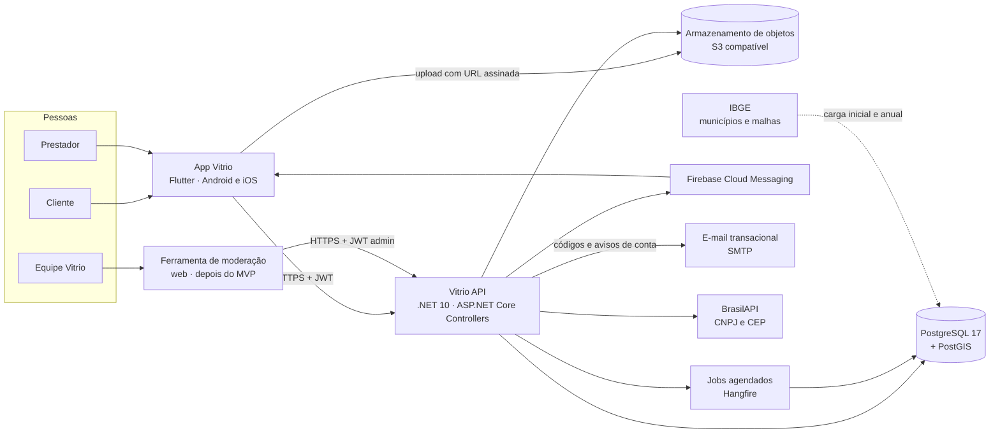
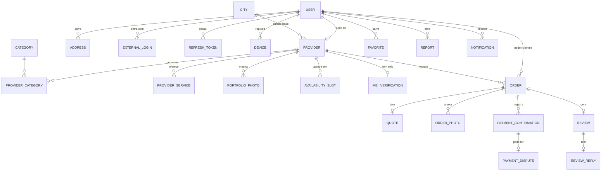

# Arquitetura

## 1. Visão de sistema



## 2. Repositório

Monorepo:

```text
vitrio/
  CLAUDE.md
  backend/            solução .NET (Vitrio.slnx)
  mobile/             app Flutter
  docs/               esta documentação, specs, planos e o design system
  infra/              docker-compose, Caddyfile, scripts de carga do IBGE
  .github/workflows/  CI do backend e do app
```

## 3. Backend

### Pilha

| Tema | Escolha | Observação |
| --- | --- | --- |
| Plataforma | .NET 10 (LTS), C# 14 | `Nullable` e `TreatWarningsAsErrors` ligados; Central Package Management |
| Web | ASP.NET Core **Controllers** (`[ApiController]`) | Decisão do projeto: **não usar Minimal APIs** (ADR-001) |
| Arquitetura | Clean Architecture com pastas por funcionalidade na Application | ADR-002 |
| Mensageria interna | `Mediator` (martinothamar, MIT, source generator) | MediatR 13+ é comercial (ADR-003) |
| Validação | FluentValidation via pipeline behavior | |
| Erros | Result pattern + ProblemDetails (RFC 9457) | Exceções só para o excepcional (ADR-004) |
| Persistência | EF Core 10 + Npgsql + NetTopologySuite | Repository por agregado (Writable para comandos, Searchable para leituras) e Unit of Work; sem repositório genérico (ADR-016) |
| Banco | PostgreSQL 17 + PostGIS, `unaccent`, `pg_trgm` | ADR-005 |
| Autenticação | Cadastro e login próprios (e-mail e senha, e-mail confirmado por código) + JWT próprio + refresh token rotativo; senha com o `PasswordHasher` do ASP.NET Core Identity (sem o resto do Identity) | Sem login social nem Keycloak (ADR-006) |
| E-mail | SMTP com MailKit; Mailpit em desenvolvimento, provedor transacional em produção | Layout em [design-system/emails.md](design-system/emails.md) |
| Jobs | Hangfire + Hangfire.PostgreSql | Lista na §7 |
| Eventos | Domain events → outbox com uma entrega por handler → despachante em `BackgroundService` | Padrão e catálogo em [10-eventos.md](10-eventos.md); sem broker no início (ADR-009) |
| Cache | `HybridCache` com memória local (L1) e Redis (L2) | Política completa em [09-cache.md](09-cache.md) (ADR-013) |
| Mapeamento | Manual, com métodos estáticos nos DTOs (`From`, `ToCommand`) | Nenhuma biblioteca de mapeamento (AutoMapper, Mapster, Mapperly) |
| Imagens | S3 compatível (Cloudflare R2 em produção, MinIO local) + SkiaSharp para processar | ADR-010; ImageSharp tem licença restrita |
| Push | Firebase Admin SDK (FCM) | |
| Documentação da API | Swashbuckle: documento OpenAPI por versão e Swagger UI em `/swagger`, com o esquema Bearer nas rotas protegidas | Só em desenvolvimento |
| Observabilidade | OpenTelemetry (traces e métricas) + Serilog (logs) → Seq em dev, Grafana/Loki/Tempo em produção | |
| Testes | xUnit, asserts nativos, NSubstitute, Testcontainers (PostGIS), `WebApplicationFactory` | FluentAssertions 8+ é comercial |
| Arquitetura | Testes de arquitetura (NetArchTest) + `/arch-check` do kit | |

### Projetos e dependências

```text
backend/
  Vitrio.slnx
  Directory.Build.props
  Directory.Packages.props
  src/
    Vitrio.Domain/            entidades, value objects, regras, eventos de domínio, Result/Error, IClock. Sem dependências externas.
    Vitrio.Application/       casos de uso por funcionalidade (comandos, consultas, validadores, DTOs), abstrações.
    Vitrio.Infrastructure/    EF Core, PostGIS, storage, FCM, BrasilAPI, Hangfire, outbox, autenticação.
    Vitrio.Api/               Controllers, filtros, middlewares, composição (Program.cs), Swagger.
  tests/
    Vitrio.Domain.Tests/
    Vitrio.Application.Tests/
    Vitrio.Api.IntegrationTests/
    Vitrio.ArchitectureTests/
```

Regras de dependência (verificadas por teste de arquitetura):

- `Domain` não referencia nenhum outro projeto nem pacote de infraestrutura.
- `Application` referencia só `Domain` (e pacotes de abstração: Mediator e FluentValidation). Não referencia EF Core: lê e grava só por repositories e `IUnitOfWork`.
- Só a `Infrastructure` conhece o `AppDbContext`; a `Api` usa repositories quando precisa gravar algo (auditoria).
- `Infrastructure` referencia `Application` e `Domain`.
- `Api` referencia `Application` e `Infrastructure` só para composição; Controllers falam apenas com `ISender`.

### Application por funcionalidade

```text
Vitrio.Application/
  Abstractions/          IUnitOfWork, ICurrentUser, IAuditLog, IObjectStorage, IPushSender, IEmailSender, ICnpjLookup, ICepLookup
  Events/                IDomainEventHandler<T> e os handlers de evento (notificações, dados derivados, cache)
  Common/                PagedResult, behaviors (log, validação, transação)
  Accounts/              Register, VerifyEmail, ResendCode, SignIn, RefreshToken, SignOut, ForgotPassword, ResetPassword, ChangePassword, Sessions, GetMe, UpdateMe, DeleteAccount, Addresses
  Cities/                LocateCity, SearchCities, GetCity
  Categories/            ListCategories
  Providers/             CreateProviderProfile, UpdateProviderProfile, SetServiceArea, SetServices, Photos, VerifyMei, Publish, Pause, SetAvailableToday, GetProviderProfile
  Search/                SearchProviders
  Orders/                CreateOrder, SendQuote, DeclineOrder, AcceptQuote, DeclineQuote, CancelOrder, CompleteOrder, ListOrders, GetOrder, ExpireOrders
  Payments/              ConfirmPayment, VoidPaymentConfirmation, DisputePayment, GetEarningsSummary
  Reviews/               CreateReview, UpdateReview, ReplyToReview, ListProviderReviews
  Reports/               CreateReport, Moderation
  Notifications/         RegisterDevice, ListNotifications, MarkAsRead, handlers de eventos
  Favorites/
```

Cada caso de uso é uma pasta com `Command`/`Query`, `Handler`, `Validator` e `Response`. Exemplo: `Orders/SendQuote/SendQuoteCommand.cs`, `SendQuoteHandler.cs`, `SendQuoteValidator.cs`.

Cada módulo tem também:

- `Repositories/`: as interfaces do módulo, uma por agregado e lado. `I<Agregado>WritableRepository` carrega o agregado rastreado e adiciona (comandos); `I<Agregado>SearchableRepository` lê com `AsNoTracking` e projeta direto para o DTO (consultas, e comandos que só precisam ler um dado auxiliar). O Searchable só existe quando há leitura. As implementações ficam em `Vitrio.Infrastructure/Persistence/Repositories`.
- `Services/`, quando preciso: regra de aplicação extensa ou usada por mais de um caso de uso, para o handler só orquestrar. Cada service tem interface própria (`IEmailCodeService`, `ISessionService`, `IPasswordService`) e implementação `internal sealed`, registrada na injeção de dependência. Service não salva nem chama `ISender`.

O handler carrega pelos repositories, chama o domínio e os services, e termina em `IUnitOfWork.SaveChangesAsync`, uma vez por comando. Handlers e services dependem só de interfaces (inversão de dependência); as implementações ficam escondidas (`internal`) na Application ou na Infrastructure.

### Controllers

Controllers são finos: recebem o request, montam o comando, chamam `ISender` e traduzem `Result` em resposta HTTP.

```csharp
[ApiController]
[Route("api/v{version:apiVersion}/provider/orders")]
[ApiVersion(1)]
[Authorize(Policy = Policies.Provider)]
public sealed class ProviderOrdersController(ISender sender) : ApiControllerBase
{
    [HttpPost("{orderId:guid}/quote")]
    [ProducesResponseType<QuoteResponse>(StatusCodes.Status200OK)]
    [ProducesResponseType<ValidationProblemDetails>(StatusCodes.Status400BadRequest)]
    [ProducesResponseType<ProblemDetails>(StatusCodes.Status404NotFound)]
    [ProducesResponseType<ProblemDetails>(StatusCodes.Status409Conflict)]
    public async Task<IActionResult> SendQuote(Guid orderId, SendQuoteRequest request, CancellationToken cancellationToken)
    {
        var result = await sender.Send(request.ToCommand(orderId), cancellationToken);
        return ToActionResult(result);
    }
}
```

`ApiControllerBase.ToActionResult` mapeia `ErrorType.Validation` → 400, `NotFound` → 404, `Conflict` → 409, `Forbidden` → 403, `Unauthorized` → 401, `Unprocessable` → 422, `RateLimited` → 429, `Unavailable` → 503, sempre como ProblemDetails com `type`, `title`, `detail`, `traceId` e, em validação, `errors`.

## 4. Modelo de domínio



Agregados e invariantes principais:

| Agregado | Raiz | Invariantes |
| --- | --- | --- |
| Conta | `User` | e-mail único; vínculo por provedor externo; estado ativo/suspenso/excluído |
| Vitrine | `Provider` | campos mínimos para publicar; até 3 categorias, 20 serviços, 30 fotos; raio 1–50 km; ponto público derivado do endereço base |
| Pedido | `Order` | máquina de estados de [02-regras-de-negocio.md](02-regras-de-negocio.md); um orçamento ativo; endereço só liberado em `Scheduled`; confirmações de pagamento imutáveis |
| Avaliação | `Review` | uma por pedido; só do cliente do pedido; janela de edição de 7 dias; uma resposta |
| Denúncia | `Report` | uma por usuário e alvo |
| Referência | `City`, `Category` | dados de carga, somente leitura para o app |

Value objects: `Money` (decimal(12,2), BRL), `IbgeCode`, `Cep`, `Cnpj`, `PhoneNumber` (E.164), `GeoPoint`, `ServiceRadius`, `Rating` (1–5), `TimeWindow`.

Ids são `Guid` versão 7 (`Guid.CreateVersion7()`), gerados no domínio. Datas são `DateTimeOffset` em UTC vindas de `IClock` (implementado na Infrastructure sobre `TimeProvider`); o fuso da cidade só entra na apresentação e em regras de horário (silêncio noturno, "Disponível hoje").

## 5. Banco de dados e geolocalização

- PostgreSQL 17 com extensões `postgis`, `unaccent`, `pg_trgm`, `citext`.
- Pontos como `geography(Point, 4326)`; limites de município como `geography(MultiPolygon, 4326)`.
- Índices: GiST em `providers.public_location` e `cities.boundary`; GIN em `providers.search_vector` (tsvector com configuração `portuguese` + `unaccent`) e trigram em `providers.display_name` e `cities.name_normalized`.
- Concorrência otimista com a coluna de sistema `xmin` (`UseXminAsConcurrencyToken`) em `Order`, `Provider` e `Review`.
- Migrações EF Core versionadas no repositório e aplicadas por um passo de deploy, nunca no startup da API em produção.

### Cidades

- Carga dos 5.570 municípios a partir da API de localidades do IBGE (código, nome, UF) e das malhas municipais simplificadas (limite e centroide). Script em `infra/ibge/`, rodado na criação do banco e uma vez por ano.
- `GET /cities/locate?lat&lng` usa `ST_Covers(boundary, ponto)`; se nenhum limite contiver o ponto (litoral, imprecisão), usa o centroide mais próximo até 30 km.

### Busca de prestadores

Com GPS:

```sql
select p.id, p.display_name, ...
from providers p
where p.status = 'Published'
  and st_dwithin(p.public_location, @point, 50000)
  and st_dwithin(p.public_location, @point, p.service_radius_m)
  and (@category_id is null or exists (select 1 from provider_categories pc where pc.provider_id = p.id and pc.category_id = @category_id))
  and (@q is null or p.search_vector @@ websearch_to_tsquery('portuguese_unaccent', @q) or p.display_name_normalized % unaccent(lower(@q)))
order by @relevance desc
limit @page_size offset @offset;
```

Sem GPS, com a cidade escolhida `@city`:

```sql
where p.status = 'Published'
  and (p.city_ibge_code = @city.ibge_code
       or st_dwithin(p.public_location, @city.boundary, p.service_radius_m))
```

- **Todo filtro e toda distância usam `public_location`**, nunca `base_location`. Filtrar pelo endereço exato deixaria descobrir o endereço variando o ponto da busca; com o ponto público, a borda do círculo só revela o centro da célula, que já é público. Isso também mantém o filtro de distância máxima coerente com a distância exibida.
- O primeiro `st_dwithin` com 50 km (raio máximo) usa o índice; o segundo aplica o raio de cada prestador.
- Sem GPS, a distância não é devolvida e a relevância não tem o componente de proximidade. `page_size` máximo 30, `offset` máximo 300 (anti-raspagem).
- "Disponível hoje" entra como condição calculada: `available_today and (available_today_set_at at time zone c.time_zone)::date = (now() at time zone c.time_zone)::date`, com `c` a cidade base.

## 6. API

- REST sobre HTTPS, JSON camelCase, versão na URL (`/api/v1`), `Asp.Versioning.Mvc`.
- Erros sempre ProblemDetails; validação com `errors` por campo.
- Paginação: `page` e `pageSize` com resposta `{ items, page, pageSize, hasMore }` (sem total em buscas públicas).
- `Idempotency-Key` obrigatório em `POST /orders`, `POST /provider/orders/{id}/quote` e `POST /provider/orders/{id}/payment-confirmation`; as chaves ficam no banco ([09-cache.md §5](09-cache.md)).
- `Cache-Control: no-store` por padrão em toda resposta; exceções só para categorias e cidades ([09-cache.md §7](09-cache.md)).
- Datas ISO 8601 com offset; dinheiro como string decimal (`"180.00"`) e moeda implícita BRL.
- Detalhes de segurança da API em [08-seguranca.md](08-seguranca.md).

### Catálogo de endpoints (v1)

| Controller | Método e rota | Quem |
| --- | --- | --- |
| Auth | `POST /auth/register`, `POST /auth/verify-email`, `POST /auth/resend-code`, `POST /auth/login`, `POST /auth/password/forgot`, `POST /auth/password/reset`, `POST /auth/refresh`, `POST /auth/logout` | público / autenticado |
| Me | `GET /me`, `PATCH /me`, `DELETE /me`, `PUT /me/password`, `GET /me/sessions`, `DELETE /me/sessions/{id}` | autenticado |
| Addresses | `GET /me/addresses`, `POST /me/addresses`, `PUT /me/addresses/{id}`, `DELETE /me/addresses/{id}` | autenticado |
| Devices | `PUT /me/devices/{installationId}`, `DELETE /me/devices/{installationId}` | autenticado |
| Cities | `GET /cities?search=`, `GET /cities/locate?lat=&lng=`, `GET /cities/{ibgeCode}` | público |
| Ceps | `GET /ceps/{cep}` | autenticado |
| Categories | `GET /categories` | público |
| Home | `GET /home?lat=&lng=&cityIbgeCode=` | público |
| Providers | `GET /providers` (busca), `GET /providers/{id}`, `GET /providers/{id}/reviews`, `GET /providers/{id}/photos` | público |
| MyProvider | `POST /provider`, `GET /provider`, `PATCH /provider`, `PUT /provider/categories`, `PUT /provider/service-area`, `PUT /provider/services`, `PUT /provider/availability`, `PUT /provider/available-today`, `POST /provider/mei-verification`, `POST /provider/publish`, `POST /provider/pause`, `GET /provider/dashboard` | prestador |
| MyProviderPhotos | `POST /provider/photos/upload-url`, `POST /provider/photos`, `PATCH /provider/photos/{id}`, `PUT /provider/photos/order`, `DELETE /provider/photos/{id}` | prestador |
| Orders | `POST /orders/photos/upload-url`, `POST /orders`, `GET /orders`, `GET /orders/{id}`, `POST /orders/{id}/quote/accept`, `POST /orders/{id}/quote/decline`, `POST /orders/{id}/cancel`, `POST /orders/{id}/complete`, `POST /orders/{id}/payment/dispute` | cliente do pedido |
| ProviderOrders | `GET /provider/orders`, `GET /provider/orders/{id}`, `POST /provider/orders/{id}/quote`, `POST /provider/orders/{id}/decline`, `POST /provider/orders/{id}/cancel`, `POST /provider/orders/{id}/complete`, `POST /provider/orders/{id}/payment-confirmation`, `POST /provider/orders/{id}/payment-confirmation/void`, `GET /provider/agenda?from=&to=` | prestador do pedido |
| ProviderEarnings | `GET /provider/earnings?month=` | prestador |
| Reviews | `POST /reviews/photos/upload-url`, `POST /orders/{id}/review`, `PUT /reviews/{id}`, `POST /reviews/{id}/reply`, `PUT /reviews/{id}/reply` | cliente / prestador |
| Favorites | `GET /me/favorites`, `PUT /me/favorites/{providerId}`, `DELETE /me/favorites/{providerId}` | autenticado |
| Reports | `POST /reports` | autenticado |
| Notifications | `GET /me/notifications`, `POST /me/notifications/{id}/read`, `POST /me/notifications/read-all`, `GET /me/notification-preferences`, `PUT /me/notification-preferences` | autenticado |
| Admin | `GET /admin/reports`, `GET /admin/reports/{targetType}/{targetId}`, `POST /admin/moderation-actions`, `POST /admin/payment-disputes/{id}/resolve`, `PUT /admin/categories/{id}` | admin |

## 7. Eventos, jobs e notificações

- **Eventos de domínio seguem [10-eventos.md](10-eventos.md)**, que tem o padrão completo e o **catálogo único** (evento, agregado, conteúdo, versão, quem consome e o que cada consumidor faz). Nenhum outro documento lista eventos.
- Resumo: só agregados geram eventos, e só nas transições a que algo fora do agregado reage (notificação, dado derivado de outro agregado, cache, outro módulo). No `SaveChanges`, cada evento vira uma linha de `outbox_messages` e uma de `outbox_deliveries` por handler, na mesma transação. Um `BackgroundService` entrega cada handler em transação própria, com retry por handler e `Failed` após 10 tentativas. Eventos não passam pelo `Mediator`.
- Auditoria não é evento: o comando grava `audit_events` na própria transação, com `IAuditLog`.
- Hangfire roda os jobs recorrentes. Painel do Hangfire só para admin, fora da internet pública.

| Job | Frequência | O que faz |
| --- | --- | --- |
| Expirar pedidos e orçamentos | 5 min | `Sent` e `Quoted` fora do prazo viram `Expired`/`QuoteExpired` |
| Concluir agendados esquecidos | 1 h | `Scheduled` 7 dias após o fim da faixa vira `Completed` pelo sistema |
| Lembretes | 5 min | Lembrete de serviço, de confirmar pagamento e convite para avaliar, respeitando o silêncio noturno |
| Revalidar selo MEI | Diário, em lotes | Revalida quem passou de 30 dias; `Pending` com mais de 3 dias vira `Failed` |
| Nota e média da categoria | Diário | Recalcula `m` de cada categoria e a nota de todos os prestadores |
| Tempo de resposta | Diário | Recalcula quem teve pedido saindo da janela de 90 dias |
| Limpar uploads órfãos | Diário | Apaga uploads não confirmados em 24 h |
| Limpar chaves de idempotência | Diário | Apaga chaves com mais de 24 h |
| Limpar notificações | Diário | Apaga notificações com mais de 90 dias |
| Anonimizar contas excluídas | Diário | Conclui a anonimização em até 30 dias |
| Limpar cadastros e códigos | Diário | Apaga contas não confirmadas em 24 h, códigos de e-mail vencidos e refresh tokens expirados |

"Disponível hoje" não tem job: é calculado na leitura ([02-regras-de-negocio.md §3](02-regras-de-negocio.md)).
- Push via FCM com o token do dispositivo; mensagens sem dados sensíveis no corpo (o app busca detalhes autenticado).

## 8. Imagens

1. O app pede `upload-url` informando tipo (`image/jpeg`, `image/png`, `image/webp`, `image/heic`) e tamanho (até 10 MB).
2. A API devolve URL assinada de `PUT` válida por 5 min, para uma chave aleatória em `incoming/`.
3. O app envia o arquivo direto para o storage e chama o endpoint de confirmação com a chave.
4. Um job valida a assinatura binária do arquivo, remove metadados (inclusive GPS do EXIF), reencoda em WebP (2048 px e miniatura de 480 px) e move para `public/` (vitrine e avaliações) ou `private/` (fotos de pedido).
5. Fotos públicas saem por CDN com chave não adivinhável; fotos de pedido só por URL assinada de leitura com 10 min, emitida para as partes do pedido.

## 9. App Flutter

O primeiro lançamento é só Android. O projeto iOS existe no repositório, mas flavors nativos e APNs entram junto com o lançamento iOS.

| Tema | Escolha |
| --- | --- |
| Estado | Riverpod (com geração de código) |
| Rotas | go_router, com redirecionamento por sessão e por modo (cliente/prestador) |
| HTTP | `http` com um `ApiClient` próprio (token, refresh, ProblemDetails, Idempotency-Key) |
| Modelos | freezed + json_serializable |
| Sessão | flutter_secure_storage (Keychain/Keystore) |
| Localização | geolocator + permission_handler, com pré-permissão |
| Imagens | image_picker + compressão no aparelho antes do upload |
| Ícones e marca | flutter_svg com os SVGs do design system |
| Push | firebase_messaging + flutter_local_notifications |
| Contato | url_launcher (WhatsApp com mensagem pronta) |
| Ambientes | flavors `dev`, `staging`, `prod` com `--dart-define` |

```text
mobile/lib/
  main_dev.dart · main_staging.dart · main_prod.dart
  app/                 app.dart, router.dart, flavors
  core/
    design_system/     tokens e widgets (ver docs/design-system/flutter.md)
    network/           api_client.dart, problem_details.dart, auth_interceptor.dart
    session/           session_controller.dart, secure_store.dart
    location/          location_service.dart, city_selection_controller.dart
    analytics/
  features/
    auth/ · onboarding_location/ · home/ · search/ · provider_profile/
    order_request/ · orders/ · review/ · account/ · notifications/
    provider_onboarding/ · provider_dashboard/ · provider_orders/ · payment_confirmation/ · agenda/
      data/            dtos, repository (chama ApiClient)
      domain/          modelos e regras de apresentação
      presentation/    screens, widgets, controllers (Riverpod)
```

## 10. Infraestrutura e entrega

- **Local:** `infra/docker-compose.yml` com PostGIS, Redis, Seq, Mailpit (caixa de e-mail de teste em `http://localhost:8025`) e a API; `dotnet run` com user-secrets. O storage S3 local é definido junto com os uploads, porque a edição comunitária do MinIO deixou de publicar imagens.
- **Produção inicial:** um servidor Linux com Docker Compose (API, Hangfire server no mesmo processo, Redis sem persistência, Caddy com TLS automático), banco PostgreSQL gerenciado com backups diários e PITR, R2 para imagens. Migração para containers gerenciados quando a carga pedir; com mais de uma instância, Redis gerenciado e rate limit no Redis ([09-cache.md](09-cache.md)). Os arquivos ficam em `infra/production/`. A imagem da API (`backend/Dockerfile`) roda sem root, sem shell e com sistema de arquivos só de leitura, e a API se recusa a subir em produção sem domínio em `AllowedHosts`, sem o proxy conhecido e sem senha no Redis.
- **CI (GitHub Actions):** build e testes (com Testcontainers), `dotnet format --verify-no-changes`, análise de vulnerabilidades de pacotes, CodeQL, gitleaks, `flutter analyze`, `flutter test` e build Android.
- **CD:** imagem Docker assinada por tag, migrações aplicadas por job separado, deploy por SSH com healthcheck e rollback.
- **Observabilidade:** `/health/live` e `/health/ready`; traces de requisição e banco; métricas de negócio (pedidos criados, orçamentos, confirmações, contestações); alertas de erro 5xx, latência p95 da busca acima de 400 ms e outbox atrasada.

## 11. Decisões (ADRs resumidos)

| # | Decisão | Motivo | Alternativa descartada |
| --- | --- | --- | --- |
| 001 | Controllers com `[ApiController]` | Preferência do time, organização por recurso, atributos de autorização e OpenAPI explícitos | Minimal APIs (padrão do kit) |
| 002 | Clean Architecture com casos de uso por funcionalidade | Domínio com regras ricas (pedido, pagamento, avaliação) e projeto de longa duração | Vertical Slice puro |
| 003 | `Mediator` (MIT) para CQRS | Licença livre, source generator, mesma ergonomia do MediatR | MediatR 13+ (comercial) |
| 004 | Result pattern + ProblemDetails | Erros de negócio são esperados; exceções ficam para falhas | Exceções de domínio mapeadas em middleware |
| 005 | PostgreSQL + PostGIS | Busca por raio e cidade com índice espacial, texto em português | SQL Server, banco de busca separado |
| 006 | Cadastro e login próprios (e-mail e senha, código por e-mail) + JWT próprio | Controle do cadastro, dos dados e das regras de acesso, sem depender de provedor; o iOS não exige login com Apple sem login social | Login social (Google, Apple), Keycloak / provedor de identidade dedicado |
| 007 | Pagamento combinado fora do app, confirmado pelo prestador | Sem custo de intermediação nem obrigações financeiras no MVP | Pagamento integrado com split |
| 008 | Ponto público do prestador | Distância útil sem expor endereço | Distância exata |
| 009 | Outbox + Hangfire, sem broker | Simples e transacional; Wolverine quando surgirem fluxos assíncronos de verdade | RabbitMQ desde o início |
| 010 | Upload direto ao storage com URL assinada e processamento em job | Não passa arquivo pela API; limpa EXIF; reencoda | Upload multipart na API |
| 011 | Monorepo | Specs, app e API evoluem juntos | Repositórios separados |
| 012 | Código em inglês; interface, docs e commits em português | Termos de domínio estáveis no código; equipe e usuários falam português | Tudo em português |
| 013 | `HybridCache` com Redis como segunda camada; banco como fonte da verdade | Cache compartilhado entre instâncias e reinícios; nada crítico (sessão revogada, idempotência) depende só do cache | Cache só em memória |
| 014 | Lançar primeiro só no Android | Público-alvo majoritariamente Android; uma loja e um fluxo de login no início | Android e iOS juntos |
| 015 | Mapeamento manual entre entidades e DTOs | Explícito, verificado pelo compilador, sem reflexão nem convenções escondidas | AutoMapper, Mapster, Mapperly |
| 016 | Repository por agregado, separado em escrita (Writable) e leitura (Searchable), com Unit of Work; services para regra extensa ou reaproveitada | Handlers curtos, consultas com nome de intenção, leitura sempre projetada e Application sem EF Core | `DbContext` direto nos handlers; repositório genérico `IRepository<T>` |
