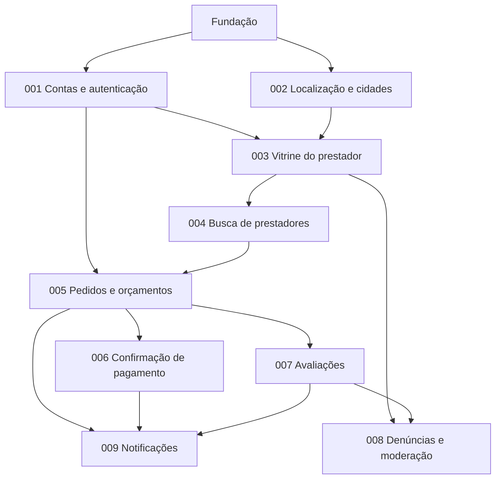

# Roadmap

Ordem sugerida de construção. Cada bloco depois da fundação corresponde a uma spec em `docs/specs/`. A numeração das specs organiza a documentação; ela não aparece em branch, commit ou código.

## Dependências

## Fundação (sem spec de funcionalidade; usar `/plan` direto)

Backend:

- `/dotnet-init` em modo greenfield com Clean Architecture; trocar o estilo de endpoint para Controllers e mesclar o `CLAUDE.md` do projeto.
- `Directory.Build.props` e `Directory.Packages.props`; analisadores; `TreatWarningsAsErrors`.
- `ApiControllerBase`, `Result`/`Error`, ProblemDetails, versionamento, política de autorização padrão, rate limiting com as políticas de [08-seguranca.md](08-seguranca.md), cabeçalhos de segurança, health checks.
- EF Core com PostGIS, `IAppDbContext`, interceptor de outbox e auditoria, `TimeProvider`.
- OpenTelemetry + Serilog com mascaramento; Seq no docker-compose.
- Projetos de teste com Testcontainers (PostGIS) e testes de arquitetura.
- CI: build, testes, format, CodeQL, pacotes vulneráveis, gitleaks.

App:

- Projeto Flutter com flavors, go_router, Riverpod, `ApiClient` com refresh e ProblemDetails.
- Design system no código (`core/design_system/` conforme `docs/design-system/flutter.md`), fontes, ícones e ícone do app.
- Telas base: boas-vindas e esqueleto das abas.

Pronto quando: `GET /health/ready` responde em staging, o app abre em dev apontando para a API local e o CI está verde.

## Construção do MVP

| Ordem | Spec | Entrega visível |
| --- | --- | --- |
| 1 | [001-contas-e-autenticacao](specs/001-contas-e-autenticacao.md) | Entrar com Google/Apple, sessão segura, conta, endereços, excluir conta |
| 2 | [002-localizacao-e-cidades](specs/002-localizacao-e-cidades.md) | Pré-permissão, cidade detectada pelo GPS, escolher qualquer cidade |
| 3 | [003-vitrine-do-prestador](specs/003-vitrine-do-prestador.md) | Onboarding do prestador, vitrine pública, fotos, serviços, selo MEI, painel inicial |
| 4 | [004-busca-de-prestadores](specs/004-busca-de-prestadores.md) | Início, categorias, busca com filtros e ordenação, favoritos |
| 5 | [005-pedidos-e-orcamentos](specs/005-pedidos-e-orcamentos.md) | Pedir orçamento, responder, aceitar, agenda, concluir, cancelar, expirações |
| 6 | [006-confirmacao-de-pagamento](specs/006-confirmacao-de-pagamento.md) | Prestador confirma valor e meio; cliente vê e contesta; resumo de recebimentos |
| 7 | [007-avaliacoes](specs/007-avaliacoes.md) | Avaliar, editar, responder, nota bayesiana, tags no perfil |
| 8 | [008-denuncias-e-moderacao](specs/008-denuncias-e-moderacao.md) | Denunciar, ocultação automática, ferramentas de moderação |
| 9 | [009-notificacoes](specs/009-notificacoes.md) | Push, central de notificações, preferências, silêncio noturno |

## Lançamento

- Contas de desenvolvedor Apple e Google, política de privacidade e termos de uso publicados, formulário de segurança de dados das lojas, exclusão de conta acessível.
- Beta fechado com prestadores reais de uma **cidade piloto** (sugestão: Jaboticabal, onde é possível cadastrar os primeiros prestadores pessoalmente). O app funciona em qualquer cidade; o piloto resolve o "ovo e galinha" da oferta.
- Metas do piloto: 50 prestadores com vitrine publicada, 100 pedidos, 60% com pagamento confirmado, nota média do app nas lojas acima de 4,5.

## Depois do MVP

| Tema | Itens |
| --- | --- |
| Conversa | Chat por pedido, remarcação com proposta de horário |
| Descoberta | Mapa de resultados, buscas recentes, indicação de prestadores pelos clientes |
| Confiança | Verificação de telefone por código, Play Integrity e App Attest, bloqueio de usuário, avaliação do cliente pelo prestador |
| Operação | Painel administrativo web (Vue), métricas de produto, e-mails transacionais |
| Prestador | Métricas de desempenho, plano Pro, link próprio da vitrine |
| Pagamento | Pagamento pelo app com taxa transparente e repasse ao prestador |
