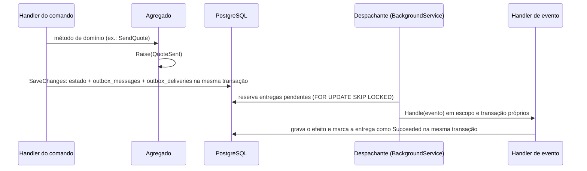

# Eventos de domínio

Como o Vitrio registra, entrega e consome eventos de domínio. Este documento é a fonte única do catálogo de eventos: specs, arquitetura e código seguem a lista da seção 9. Quando uma spec precisar de um evento novo, ele entra aqui primeiro.

## 1. Quando usar evento

Use evento de domínio quando uma mudança num agregado precisa provocar algo **fora dele**, sem que o caso de uso original espere por isso:

- avisar alguém (notificação na central e push);
- atualizar dados derivados de outro agregado (nota, tempo de resposta e serviços feitos no `Provider`);
- invalidar cache;
- reagir em outro módulo (suspensão cancela pedidos, exclusão de conta remove a vitrine).

Não use evento para:

| Situação | Use em vez disso | Por quê |
| --- | --- | --- |
| Auditoria (`audit_events`) | Gravação na **mesma transação** do comando, pelo `IAuditLog` | Registro legal não pode atrasar nem se perder |
| Validar ou decidir uma regra do próprio agregado | Método do domínio | Regra fica no agregado, com teste de unidade |
| Algo que depende de horário (lembrete 1 h antes, expiração em 48 h, conclusão automática de pedido agendado) | Job recorrente do Hangfire que varre o banco | Horário não é consequência de uma mudança; o job é idempotente e se recupera sozinho de atrasos |
| Selo que vale só por um período ("Disponível hoje") | Cálculo na leitura ([02-regras-de-negocio.md](02-regras-de-negocio.md) §3) | Não precisa de job nem de evento para "desligar" na virada do dia |
| Chamar serviço externo (FCM, BrasilAPI, storage) direto no handler | Tabela de trabalho própria (ex.: `PushDelivery`) processada pelo seu worker | Efeito externo não participa da transação do banco |

## 2. Fluxo



1. O agregado registra o evento com `Raise`. Nada é publicado nesse momento.
2. No `SaveChanges`, o interceptor transforma cada evento em uma linha de `outbox_messages` e uma linha de `outbox_deliveries` **por handler inscrito**, na mesma transação do estado. Se a transação falha, nenhum evento existe.
3. O despachante reserva entregas pendentes e executa **cada handler separadamente**, cada um em sua transação.
4. O efeito do handler e a marcação `Succeeded` da entrega são confirmados juntos. Uma falha afeta só aquele handler; os outros do mesmo evento seguem.

## 3. Contrato do evento

### Forma

```csharp
public abstract record DomainEvent
{
    public Guid EventId { get; init; } = Guid.CreateVersion7();
}

[AttributeUsage(AttributeTargets.Class, Inherited = false)]
public sealed class EventTypeAttribute(string name, int version) : Attribute
{
    public string Name { get; } = name;
    public int Version { get; } = version;
}

[EventType("quote.sent", 1)]
public sealed record QuoteSent(Guid OrderId, Guid CustomerId, Guid ProviderId, int QuoteVersion) : DomainEvent;
```

- `DomainEvent` e `EventTypeAttribute` ficam no `Vitrio.Domain`, sem dependência externa.
- Nome do `record` no passado e em inglês (`QuoteSent`, `OrderCancelled`).
- Todo evento tem `[EventType]` com **nome estável** (`<agregado>.<fato>`, minúsculo, com `_`) e **versão**. O nome estável é o que vai para o banco; renomear ou mover a classe não quebra mensagens pendentes.
- O instante do evento (`occurred_at`) é gravado pelo interceptor a partir do `IClock`.
- Um tipo por arquivo: cada evento no seu arquivo, com o nome do evento.

### O que vai no payload

- **Só ids e códigos de roteamento**: ids dos envolvidos, versão do orçamento, quem agiu (`CancelledBy`, `CompletedBy`), código de motivo, resultado (`Outcome`), flags (`Automatic`, `WithinTwoHours`).
- **Nunca**: nome, telefone, e-mail, endereço, coordenadas, texto livre (mensagem, comentário, motivo digitado), valores em dinheiro.
- O handler que precisa de mais dados (o valor do orçamento para o texto da notificação, por exemplo) lê o **estado atual** no banco. Assim o payload não envelhece e não espalha dado pessoal pela outbox.

### Versionamento

- Mudança aditiva (campo novo opcional): mesma versão; o deserializador tolera campo ausente.
- Mudança incompatível (remover, renomear ou mudar o tipo de um campo): nova versão (`quote.sent` v2). O código mantém o leitor da v1 até que não exista mais entrega pendente da v1.
- Um teste de contrato serializa cada evento e compara com o JSON de referência (seção 8).

## 4. Gerar eventos no domínio

```csharp
public abstract class AggregateRoot
{
    private readonly List<DomainEvent> _domainEvents = [];

    public IReadOnlyList<DomainEvent> DomainEvents => _domainEvents;

    protected void Raise(DomainEvent domainEvent) => _domainEvents.Add(domainEvent);

    public void ClearDomainEvents() => _domainEvents.Clear();
}
```

- Evento só nasce dentro de um método de domínio, junto da mudança de estado que ele descreve.
- **Proibido `ExecuteUpdate`/`ExecuteDelete` em agregado que gera evento.** Atualização em massa não passa pelo interceptor e o evento some. Jobs em lote (expirar pedidos, concluir pedidos agendados esquecidos, revalidar MEI) carregam as entidades em páginas, chamam o método de domínio e salvam.
- Um handler de evento pode alterar outro agregado, que gera seus próprios eventos: a cadeia segue pela outbox (ex.: `review.published` → nota recalculada → `provider.stats_updated` → cache do perfil invalidado).

## 5. Outbox

### Tabelas

```sql
create table outbox_messages (
  id           uuid primary key,          -- EventId
  type         text        not null,      -- nome estável, ex.: quote.sent
  version      int         not null,
  payload      jsonb       not null,
  occurred_at  timestamptz not null
);

create table outbox_deliveries (
  message_id       uuid        not null references outbox_messages (id),
  handler          text        not null,  -- nome do handler, ex.: OrderNotifications
  status           text        not null,  -- Pending, Succeeded, Failed
  attempts         int         not null default 0,
  next_attempt_at  timestamptz not null,
  locked_until     timestamptz,
  last_error       text,                  -- tipo da exceção e código; nunca a mensagem completa
  processed_at     timestamptz,
  primary key (message_id, handler)
);

create index ix_outbox_deliveries_pending on outbox_deliveries (next_attempt_at)
  where status = 'Pending';
```

### Interceptor

```csharp
public sealed class OutboxInterceptor(IClock clock, DomainEventRegistry registry) : SaveChangesInterceptor
{
    public override ValueTask<InterceptionResult<int>> SavingChangesAsync(
        DbContextEventData eventData, InterceptionResult<int> result, CancellationToken cancellationToken = default)
    {
        var context = eventData.Context!;
        var now = clock.UtcNow;

        var aggregates = context.ChangeTracker.Entries<AggregateRoot>()
            .Select(entry => entry.Entity)
            .Where(aggregate => aggregate.DomainEvents.Count > 0)
            .ToList();

        foreach (var aggregate in aggregates)
        {
            foreach (var domainEvent in aggregate.DomainEvents)
            {
                var message = OutboxMessage.From(domainEvent, registry, now);
                context.Add(message);
                context.AddRange(registry.HandlersFor(domainEvent).Select(handler => OutboxDelivery.Create(message.Id, handler, now)));
            }

            aggregate.ClearDomainEvents();
        }

        return base.SavingChangesAsync(eventData, result, cancellationToken);
    }
}
```

- `DomainEventRegistry` é montado no startup: mapeia cada nome estável para o tipo do evento e para a lista de handlers inscritos. Evento sem `[EventType]` ou com nome repetido derruba o startup.
- O interceptor só grava a outbox. As datas das entidades (`CreatedAt` e afins) são definidas pelo domínio com `IClock`; o registro em `audit_events` é feito pelo comando, com `IAuditLog` (seção 1).

## 6. Despachante

### Handlers de evento

```csharp
public interface IDomainEventHandler<in TEvent> where TEvent : DomainEvent
{
    ValueTask Handle(TEvent domainEvent, CancellationToken cancellationToken);
}
```

- A interface fica na `Vitrio.Application`. **Eventos não passam pelo `Mediator`.** O `Mediator` continua para comandos e consultas.
  - Motivo 1: com `INotification`, o domínio passaria a referenciar o pacote, o que quebra a regra "Domain sem dependências externas".
  - Motivo 2: o `Publish` do `Mediator` roda todos os handlers juntos, e o retry precisa ser por handler.
- Os handlers são registrados por reflexão no startup (`AddDomainEventHandlers`), sem pacote extra. Uma classe pode tratar vários eventos (`OrderNotifications` implementa `IDomainEventHandler<OrderCreated>`, `IDomainEventHandler<QuoteSent>` etc.).
- O nome gravado em `outbox_deliveries.handler` é o nome da classe. Renomear a classe com entregas pendentes exige atualizar essas linhas na mesma migração.

### Reserva e processamento

O despachante é um `BackgroundService` que, a cada **1 segundo**, reserva até **50 entregas**:

```sql
update outbox_deliveries d
set locked_until = @now + interval '60 seconds',
    attempts     = d.attempts + 1
where (d.message_id, d.handler) in (
  select message_id, handler
  from outbox_deliveries
  where status = 'Pending'
    and next_attempt_at <= @now
    and (locked_until is null or locked_until < @now)
  order by next_attempt_at
  limit 50
  for update skip locked)
returning d.message_id, d.handler, d.attempts;
```

- `FOR UPDATE SKIP LOCKED` + `locked_until` permitem várias instâncias da API sem processar a mesma entrega duas vezes. Se uma instância morre no meio, a entrega volta a ficar disponível quando `locked_until` vence.
- Cada entrega roda em um escopo de DI novo e em uma transação própria. O efeito do handler e `status = 'Succeeded'` são confirmados juntos.
- Leitura a cada 1 s atende às metas atuais (push em até 30 s e nota em até 1 min). `LISTEN/NOTIFY` do PostgreSQL fica para quando a latência precisar cair.

### Falhas e retry

| Tentativa | Próxima tentativa em |
| --- | --- |
| n (1 a 9) | `agora + min(5 s × 2^(n−1), 1 h)` |
| 10 falhou | `status = 'Failed'` e alerta |

- O retry total cobre cerca de 1h25, cobrindo quedas curtas de banco ou de dependência.
- `last_error` guarda o tipo da exceção e o código do erro, **nunca a mensagem completa**, que pode conter dado pessoal. O log segue a política de mascaramento do Serilog.
- Entrega `Failed` não some: fica para análise. O reprocessamento é feito por comando interno de admin (`RetryOutboxDelivery`), que volta a entrega para `Pending` com `attempts = 0` e grava auditoria. No MVP não há endpoint público para isso.

### Ordem

**Não há garantia de ordem entre eventos.** Uma entrega que falhou pode ser concluída depois de outra mais nova. Por isso todo handler:

- lê o **estado atual** do agregado em vez de confiar no payload ou na sequência;
- descarta o efeito quando o evento perdeu sentido (ex.: aviso de "orçamento recebido" para um pedido que já foi cancelado não vira push; fica só na central).

## 7. Regras para handlers

1. **Idempotente.** Rodar duas vezes produz o mesmo resultado. Padrões aceitos:
   - recalcular a partir do estado (nota, tempo de resposta, serviços feitos), nunca incrementar;
   - índice único que impede duplicata (notificação: único em `event_id`, `user_id`, `type`);
   - conferir o estado atual antes de agir.
2. **Só banco e cache.** O handler grava no banco e, no máximo, invalida cache. Push, HTTP e storage saem por tabela de trabalho própria (`PushDelivery`, spec 009) e pelo worker dela, com retry próprio.
3. **Sem `ISender` dentro do handler.** Chame o domínio direto. O pipeline do `Mediator` abriria uma transação dentro da transação da entrega.
4. **Um propósito por handler.** "Avisar" e "recalcular nota" são handlers diferentes, para falharem e tentarem de novo de forma independente.
5. **Tempo do `IClock`, `CancellationToken` repassado, nada de dado pessoal em log.**
6. **Rápido.** Cada entrega termina em segundos. Trabalho pesado (processar imagem, revalidar CNPJ) é job, não handler.

## 8. Testes

| O quê | Onde | Como |
| --- | --- | --- |
| O método de domínio gera o evento certo | `Vitrio.Domain.Tests` | Chamar o método e conferir `DomainEvents` (tipo e campos) |
| Outbox na mesma transação | `Vitrio.Application.Tests` (Testcontainers) | `SaveChanges` grava estado + `outbox_messages` + uma `outbox_deliveries` por handler; com falha, nada é gravado |
| Handler idempotente | `Vitrio.Application.Tests` | Processar a mesma entrega duas vezes e conferir o mesmo resultado |
| Retry por handler | `Vitrio.Application.Tests` | Um handler falha e o outro do mesmo evento conclui; o que falhou vai para `next_attempt_at` futuro |
| Contrato | `Vitrio.Domain.Tests` | Para cada evento, serializar e comparar com o JSON de referência por nome e versão |
| Registro completo | `Vitrio.ArchitectureTests` | Todo `DomainEvent` concreto tem `[EventType]` com nome único; `Vitrio.Domain` não referencia `Mediator`; handlers de evento são `sealed` |

Nome de teste descreve o comportamento: `ConfirmPayment_WhenCompleted_RaisesPaymentConfirmed`, `RecalculateProviderRating_WhenRunTwice_KeepsSameScore`.

## 9. Catálogo

Fonte única dos eventos do Vitrio. Specs, arquitetura e código apontam para esta tabela; evento novo entra aqui antes de entrar no código.

- **Conteúdo:** os campos do `record`, só ids e códigos (seção 3).
- **Versão:** a do `[EventType]`. Mudança incompatível cria uma linha nova com a versão seguinte e mantém a anterior até não haver entrega pendente dela.
- **Quem consome** e **o que cada consumidor faz** estão na mesma ordem. Os handlers de notificação seguem a tabela de tipos e textos de [specs/009-notificacoes.md](specs/009-notificacoes.md) e de [design-system/telas.md](design-system/telas.md).

| Evento | Agregado | Gerado quando | Conteúdo | Versão | Quem consome | O que cada consumidor faz |
| --- | --- | --- | --- | --- | --- | --- |
| `user.deleted` (`UserDeleted`) | `User` | Exclusão de conta confirmada | `UserId` | 1 | `CancelOpenOrdersOfRemovedUser`<br>`RemoveProviderProfileOfDeletedUser`<br>`InvalidateProviderProfileCache` | Cancela os pedidos `Sent` e `Quoted` em que a pessoa é cliente ou prestador, com motivo "Conta excluída" (`Scheduled` já bloqueia a exclusão)<br>Passa a vitrine a `Removed`: sai da busca e do perfil público e libera o CNPJ<br>Remove o perfil público do cache |
| `user.suspended` (`UserSuspended`) | `User` | Admin suspende a conta | `UserId`, `SuspendedUntil?` | 1 | `CancelOpenOrdersOfRemovedUser`<br>`AccountNotifications`<br>`InvalidateProviderProfileCache` | Cancela `Sent`, `Quoted` e `Scheduled` com motivo "Conta suspensa"<br>Avisa a pessoa suspensa<br>Remove o perfil público do cache |
| `user.reactivated` (`UserReactivated`) | `User` | Admin reativa a conta | `UserId` | 1 | `AccountNotifications`<br>`InvalidateProviderProfileCache` | Avisa a pessoa reativada<br>Remove o perfil público do cache |
| `provider.published` (`ProviderPublished`) | `Provider` | Vitrine publicada ou despausada | `ProviderId` | 1 | `InvalidateProviderProfileCache` | Remove o perfil público do cache |
| `provider.paused` (`ProviderPaused`) | `Provider` | Prestador pausa a vitrine | `ProviderId` | 1 | `InvalidateProviderProfileCache` | Remove o perfil público do cache |
| `provider.profile_updated` (`ProviderProfileUpdated`) | `Provider` | Qualquer mudança pública feita pelo dono: dados, categorias, serviços, área, disponibilidade, "Disponível hoje" e fotos (inclusive foto processada ou rejeitada) | `ProviderId` | 1 | `InvalidateProviderProfileCache` | Remove o perfil público do cache |
| `provider.stats_updated` (`ProviderStatsUpdated`) | `Provider` | Nota, número de avaliações, tempo de resposta ou serviços feitos mudaram | `ProviderId` | 1 | `InvalidateProviderProfileCache` | Remove o perfil público do cache |
| `mei.verified` (`MeiVerified`) | `Provider` | Consulta confirma CNPJ ativo e optante pelo MEI | `ProviderId`, `FromPending` | 1 | `InvalidateProviderProfileCache`<br>`AccountNotifications` | Remove o perfil público do cache<br>Avisa o prestador, só quando `FromPending` (a resposta não saiu na hora) |
| `mei.verification_failed` (`MeiVerificationFailed`) | `Provider` | Consulta recusa o CNPJ, ou a verificação ficou `Pending` por 3 dias | `ProviderId`, `ReasonCode`, `FromPending` | 1 | `AccountNotifications` | Avisa o prestador com o motivo, só quando `FromPending` |
| `mei.verification_lost` (`MeiVerificationLost`) | `Provider` | Revalidação perde o selo | `ProviderId` | 1 | `AccountNotifications`<br>`InvalidateProviderProfileCache` | Avisa o prestador que o selo saiu<br>Remove o perfil público do cache |
| `order.created` (`OrderCreated`) | `Order` | Cliente envia o pedido | `OrderId`, `CustomerId`, `ProviderId` | 1 | `OrderNotifications` | Avisa o prestador: novo pedido |
| `order.declined` (`OrderDeclined`) | `Order` | Prestador recusa | `OrderId`, `CustomerId`, `ProviderId` | 1 | `OrderNotifications`<br>`RecalculateProviderResponseTime` | Avisa o cliente, com sugestão de outros prestadores<br>Recalcula o tempo de resposta do prestador |
| `order.expired` (`OrderExpired`) | `Order` | 48 h sem resposta (job) | `OrderId`, `CustomerId`, `ProviderId` | 1 | `OrderNotifications`<br>`RecalculateProviderResponseTime` | Avisa o cliente, com sugestão de outros prestadores<br>Recalcula o tempo de resposta (o pedido entra como 48 h) |
| `quote.sent` (`QuoteSent`) | `Order` | Prestador envia ou substitui o orçamento | `OrderId`, `CustomerId`, `ProviderId`, `QuoteVersion` | 1 | `OrderNotifications`<br>`RecalculateProviderResponseTime` | Avisa o cliente: orçamento recebido<br>Recalcula o tempo de resposta, só quando `QuoteVersion = 1` |
| `quote.accepted` (`QuoteAccepted`) | `Order` | Cliente aceita | `OrderId`, `CustomerId`, `ProviderId`, `QuoteVersion` | 1 | `OrderNotifications` | Avisa o prestador: orçamento aceito |
| `quote.declined` (`QuoteDeclined`) | `Order` | Cliente recusa o orçamento | `OrderId`, `CustomerId`, `ProviderId` | 1 | `OrderNotifications` | Avisa o prestador: orçamento recusado |
| `quote.expired` (`QuoteExpired`) | `Order` | Orçamento sem decisão até a validade (job) | `OrderId`, `CustomerId`, `ProviderId` | 1 | `OrderNotifications` | Avisa os dois |
| `order.cancelled` (`OrderCancelled`) | `Order` | Cliente, prestador ou sistema cancela | `OrderId`, `CustomerId`, `ProviderId`, `CancelledBy` (`Customer`, `Provider`, `System`), `ReasonCode`, `WithinTwoHours` | 1 | `OrderNotifications`<br>`RecordLateCancellation` | Avisa o outro lado (os dois quando `System`)<br>Recalcula `LateCancellations90d` do prestador, só quando `Provider` e `WithinTwoHours`; com 3 ou mais, abre item na fila de moderação |
| `order.completed` (`OrderCompleted`) | `Order` | Cliente ou prestador marca concluído, ou o job conclui 7 dias após a faixa | `OrderId`, `CustomerId`, `ProviderId`, `CompletedBy` (`Customer`, `Provider`, `System`) | 1 | `OrderNotifications`<br>`RecalculateCompletedOrders` | Avisa o outro lado (os dois quando `System`)<br>Recalcula os serviços feitos do prestador |
| `order.address_released` (`AddressReleased`) | `Order` | Pedido vira `Scheduled` | `OrderId`, `ProviderId` | 1 | — | Nenhum consumidor no MVP; a auditoria da liberação é gravada na transação do aceite |
| `payment.confirmed` (`PaymentConfirmed`) | `Order` | Prestador confirma o recebimento | `OrderId`, `CustomerId`, `ProviderId`, `ConfirmationId` | 1 | `PaymentNotifications` | Avisa o cliente: pagamento confirmado |
| `payment.confirmation_voided` (`PaymentConfirmationVoided`) | `Order` | Prestador anula em até 24 h | `OrderId`, `CustomerId`, `ProviderId`, `ConfirmationId` | 1 | `PaymentNotifications` | Avisa o cliente: confirmação anulada |
| `payment.disputed` (`PaymentDisputed`) | `Order` | Cliente contesta | `OrderId`, `CustomerId`, `ProviderId`, `DisputeId` | 1 | `PaymentNotifications` | Avisa o prestador: pagamento contestado |
| `payment.dispute_resolved` (`PaymentDisputeResolved`) | `Order` | Suporte resolve a contestação | `OrderId`, `CustomerId`, `ProviderId`, `DisputeId`, `Outcome` (`Kept`, `Voided`) | 1 | `PaymentNotifications`<br>`RecalculateCompletedOrders`<br>`RecordUpheldDispute` | Avisa os dois<br>Recalcula os serviços feitos, só quando `Voided` (pedido `PaymentVoided` não conta)<br>Registra a contestação procedente para a moderação, só quando `Voided` |
| `review.published` (`ReviewPublished`) | `Review` | Cliente avalia | `ReviewId`, `OrderId`, `CustomerId`, `ProviderId` | 1 | `ReviewNotifications`<br>`RecalculateProviderRating` | Avisa o prestador, só se a avaliação está `Visible`<br>Recalcula a nota do prestador |
| `review.updated` (`ReviewUpdated`) | `Review` | Cliente edita em até 7 dias | `ReviewId`, `ProviderId` | 1 | `RecalculateProviderRating` | Recalcula a nota do prestador |
| `review.replied` (`ReviewReplied`) | `Review` | Prestador responde | `ReviewId`, `CustomerId`, `ProviderId` | 1 | `ReviewNotifications` | Avisa o cliente: resposta à avaliação |
| `content.hidden` (`ContentHidden`) | `Report` (moderação) | Terceira denúncia de foto, avaliação ou resposta, ou ação de admin | `TargetType` (`Photo`, `Review`, `ReviewReply`), `TargetId`, `OwnerUserId`, `ProviderId`, `Automatic` | 1 | `AccountNotifications`<br>`RecalculateProviderRating`<br>`InvalidateProviderProfileCache` | Avisa o autor<br>Recalcula a nota, só quando `Review`<br>Remove o perfil público do cache |
| `content.restored` (`ContentRestored`) | `Report` (moderação) | Admin restaura conteúdo oculto ou aprova avaliação `UnderReview` | `TargetType`, `TargetId`, `OwnerUserId`, `ProviderId` | 1 | `AccountNotifications`<br>`RecalculateProviderRating`<br>`InvalidateProviderProfileCache` | Avisa o autor, só quando o conteúdo estava oculto<br>Recalcula a nota, só quando `Review`<br>Remove o perfil público do cache |
| `category.updated` (`CategoryUpdated`) | `Category` | Admin altera uma categoria | `CategoryId` | 1 | `InvalidateCategoriesCache` | Remove a tag `categories` do cache |

- Não existem `ReviewHidden` nem `ReviewRestored`: ocultar, restaurar e aprovar avaliação usam `content.hidden` e `content.restored` com `TargetType = Review`.
- Vitrine não é ocultada por denúncia; sai do ar por suspensão (`user.suspended`).
- Cadastro, confirmação de e-mail, login e troca de senha não geram evento: ninguém reage a eles fora do caso de uso, e a auditoria é gravada na transação do comando.

### Handlers de dados derivados

| Handler | Recalcula | Regra |
| --- | --- | --- |
| `RecalculateProviderRating` | `ReviewCount`, `RatingSum`, `RatingScore`, `RatingDistribution`, `TagCounts`, `RecommendCount` | A partir das avaliações `Visible`; média bayesiana de [02-regras-de-negocio.md](02-regras-de-negocio.md) §6 |
| `RecalculateProviderResponseTime` | `ResponseTimeBucket`, `ResponseSampleSize` | Mediana dos últimos 20 pedidos recebidos em 90 dias que foram respondidos ou expiraram; expirado conta como 48 h; menos de 5 deixa `null` ([02-regras-de-negocio.md](02-regras-de-negocio.md) §3) |
| `RecalculateCompletedOrders` | `CompletedOrders` | Pedidos do prestador em `Completed`, `PaymentConfirmed` ou `PaymentDisputed` |
| `RecordLateCancellation` | `LateCancellations90d` | Cancelamentos do prestador com menos de 2 h nos últimos 90 dias; com 3 ou mais, abre item na fila de moderação ([02-regras-de-negocio.md](02-regras-de-negocio.md) §4) |
| `RecordUpheldDispute` | Contestações procedentes do prestador | Registro para a moderação; o limite que abre revisão está pendente (seção 12) |

Os três primeiros chamam o método de domínio do `Provider` e só geram `provider.stats_updated` quando algum valor **muda**.

## 10. Jobs agendados que geram eventos

Os jobs do Hangfire seguem a seção 4: carregam em páginas, chamam o domínio e salvam. Os eventos saem pela outbox como em qualquer comando. A lista completa de jobs e frequências está em [03-arquitetura.md](03-arquitetura.md) §7.

| Job | Eventos |
| --- | --- |
| Expirar pedidos e orçamentos | `order.expired`, `quote.expired` |
| Concluir agendados esquecidos | `order.completed` (`CompletedBy = System`) |
| Revalidar selo MEI e reprocessar `Pending` | `mei.verified`, `mei.verification_failed`, `mei.verification_lost` |
| Recalcular tempo de resposta (janela de 90 dias) | `provider.stats_updated`, quando o valor muda |
| Recalcular média da categoria e notas | `provider.stats_updated`, quando a nota muda |
| Lembretes, limpezas, anonimização | Nenhum: criam notificações ou apagam dados direto, conferindo o estado atual |

## 11. Operação

| Métrica (`Meter("Vitrio")`) | Alerta |
| --- | --- |
| `outbox.pending` (entregas `Pending`) | — |
| `outbox.oldest_pending_seconds` | Acima de 120 s (é o alerta de "outbox atrasada" de [03-arquitetura.md](03-arquitetura.md)) |
| `outbox.failed` (entregas `Failed`) | Qualquer valor acima de 0 |
| Duração por handler (histograma) | p95 acima de 5 s |

- Log por entrega: nome estável do evento, `message_id`, handler, tentativa e resultado. Nunca o payload.
- Retenção: mensagens concluídas por 30 dias; `Failed` até alguém resolver.

## 12. Decisões

- Eventos usam `IDomainEventHandler<T>` próprio, não `INotification` do `Mediator`.
- Conteúdo só com ids e códigos; o handler lê o estado atual quando precisa de mais.
- Auditoria (`audit_events`) é gravada na transação do comando, fora da outbox.
- `ExecuteUpdate`/`ExecuteDelete` são proibidos em agregado que gera evento.
- A invalidação do cache do perfil público é feita por evento (`InvalidateProviderProfileCache`), cerca de 1 a 2 s depois da mudança, inclusive para mudanças vindas de jobs e moderação ([09-cache.md](09-cache.md) §3).
- Lembretes são criados por job de varredura, não agendados a partir de evento.
- "Disponível hoje" é calculado na leitura; não há job nem evento para desligá-lo.

### Pendente de decisão de produto

- Contestação procedente (`RecordUpheldDispute`): a revisão manual começa a partir de quantas ocorrências? A spec 006 propõe 2 em 90 dias.
